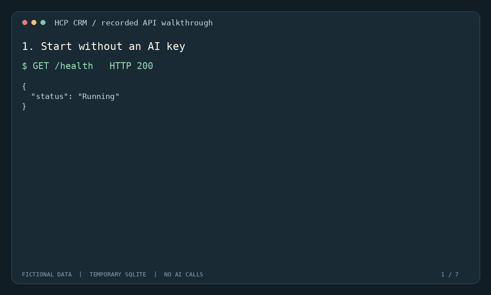
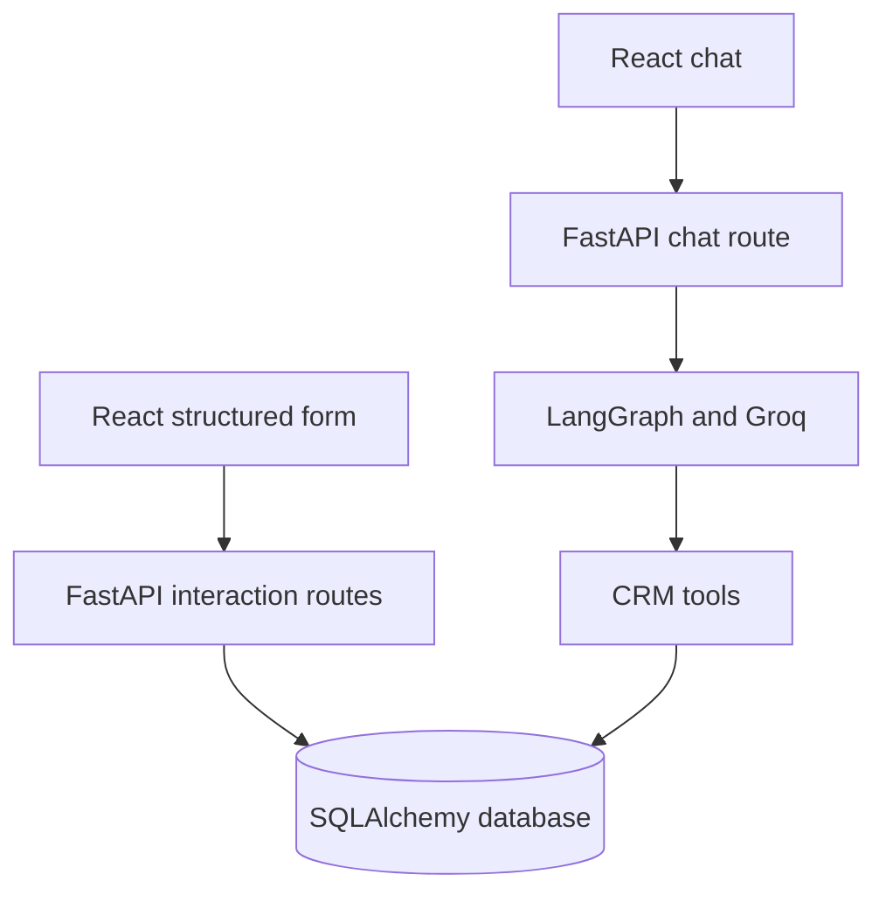

# AI-first HCP CRM

A full-stack learning project for recording and reviewing fictional healthcare-professional interactions. Structured logging calls a validated API directly; optional AI chat uses a LangGraph agent and Groq to select CRM tools.

**Why two paths?** Entering structured fields should not require an LLM, a paid API call, or natural-language interpretation. The AI assistant remains useful for conversational requests, while the structured workflow can run independently.



## What works

- Create and list HCP records.
- Create, read, update, and delete interactions through FastAPI routes.
- Validate nonblank summaries, positive HCP IDs, dates, and follow-up order.
- Reject writes referencing unknown HCPs; preserve data when an update fails validation.
- Submit the React form directly to the interaction API, retaining entered data if a save fails.
- Optionally search, log, edit, and review interactions through a LangGraph tool-calling agent.

## Quick demo: no API key or PostgreSQL required

Requires **Python 3.12**. From the repository root:

```bash
python -m venv .venv
# Windows PowerShell:
.venv\Scripts\Activate.ps1
# macOS / Linux:
# source .venv/bin/activate
python -m pip install -r backend/requirements-dev.txt
python scripts/demo.py
python -m pytest backend/tests -q
```

The demo uses a temporary SQLite database, fictional records, and no external model calls. It exercises successful writes, rejected writes, data preservation, and unavailable-chat behavior. `docs/demo-results.json` contains the output captured from `python scripts/demo.py --record`; the GIF illustrates those recorded API responses, not a browser recording or a live AI session.

## Run the application

### Backend

In the activated environment, from the repository root:

```bash
python scripts/seed_demo.py
python -m uvicorn app.main:app --app-dir backend --reload --port 8000
```

The seed command prints the fictional HCP ID to use in the form. It adds the record if needed and does not delete existing records. The default database is `crm_demo.db` in the current working directory. API documentation: `http://127.0.0.1:8000/docs`.

### Frontend

Requires **Node.js 24** and npm. In a second terminal:

```bash
cd frontend
npm ci
npm run dev
```

Open the local URL printed by Vite. The API defaults to `http://127.0.0.1:8000`. To use a different backend, set `VITE_API_BASE_URL` in `frontend/.env` before starting/building the frontend. Cross-origin backend origins must also be allowed by CORS in `backend/app/main.py`.

### Optional AI chat and PostgreSQL

```bash
python -m pip install -r backend/requirements.txt
```

Copy `.env.example` to `.env` in the repository root. Set a real `GROQ_API_KEY` to enable chat. The configured model is `llama-3.3-70b-versatile`; availability depends on the provider. For PostgreSQL, create an empty database and set `DATABASE_URL` to its connection URL. Restart the backend after changing environment variables. Never commit actual credentials.

The six AI tools are `get_all_hcp`, `search_hcp`, `get_interactions`, `log_interaction`, `edit_interaction`, and `suggest_next_action`. The last tool returns a simple rule-based suggestion; it is not a clinical recommendation engine.

## Architecture



| Layer | Technology | Responsibility |
| --- | --- | --- |
| UI | React, Redux Toolkit, Axios, Vite | Form state, chat history, HTTP requests |
| API | FastAPI, Pydantic | Input validation and response contracts |
| Persistence | SQLAlchemy; SQLite locally, PostgreSQL optionally | HCP and interaction records |
| Optional agent | LangGraph, LangChain, Groq | Natural-language tool selection |

## Verification

```bash
python -m pytest backend/tests -q
python scripts/demo.py
cd frontend
npm test
npm run build
```

The regression suite covers CRUD, missing records, unknown HCP references, optional fields, whitespace-only inputs, invalid dates, rejected writes, and unavailable AI. Chat tests stub the agent: they verify API behavior, **not live model quality or tool-selection accuracy**. The frontend tests cover payload construction and validation; they are not browser end-to-end tests. GitHub Actions runs the API tests, isolated demo, frontend tests, and build on pushes and pull requests.

## Engineering decisions and limits

- **Deterministic form writes:** structured data uses the API directly instead of being converted into an AI prompt.
- **Optional AI dependency:** credentials and agent imports are needed only when chat is called; basic application startup does not require them.
- **Validation boundaries:** API schemas enforce input rules; routes verify referenced HCPs before writes. Agent tools currently have their own validation and do not inherit every API-schema rule.
- **Explicit failures:** missing records return 404; invalid payloads return 422; unavailable chat returns 503 without provider error details.
- **Local schema creation:** tables are created on startup for convenience. Production schema migrations are not implemented.
- **Prototype scope:** no authentication, user authorization, audit trail, or comprehensive rate limiting. Use fictional data locally. This project is not a production healthcare system.
- **Write safety:** chat tools can write data without confirmation. Prompt instructions do not guarantee exactly-once execution. Idempotency and explicit confirmation for agent writes are future work.
- **Database coverage:** automated tests use SQLite. PostgreSQL behavior and live Groq calls have not been verified by this suite.

## Review and demo notes

See [the 90-second walkthrough](docs/DEMO.md) and [the engineering change notes](docs/ENGINEERING.md) for the problems fixed and what to explain in an interview.
